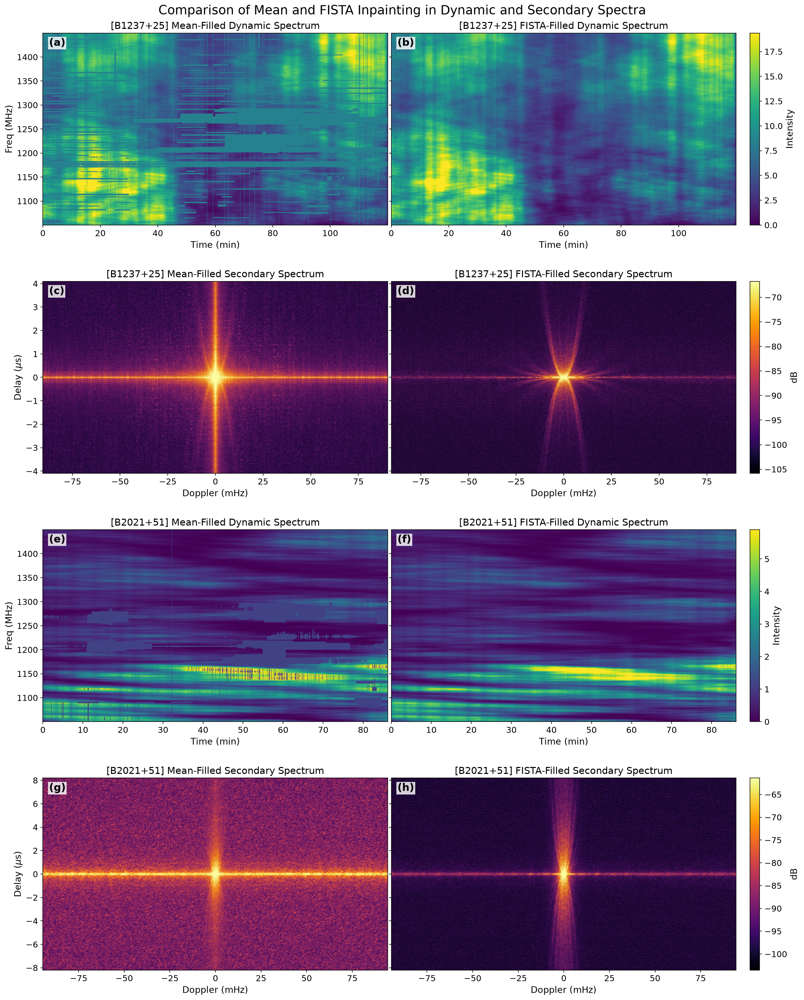
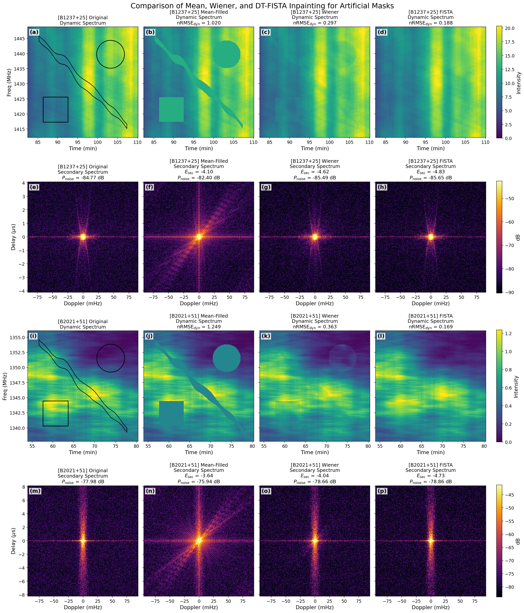
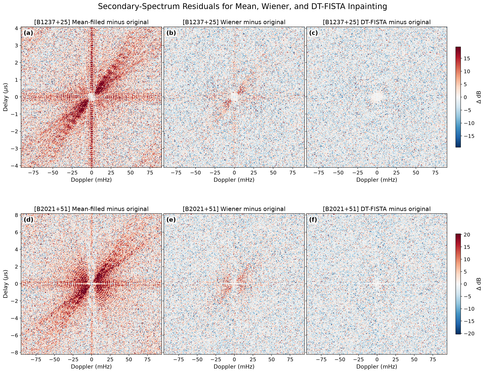

# DT-FISTA: Inpainting Pulsar Dynamic Spectra via Fourier Sparsity

## Project overview

### Background

Pulsar radio waves are scattered by electron-density irregularities in the ionized interstellar medium. The resulting interference changes with time and observing frequency, producing interstellar scintillation. A dynamic spectrum records the intensity as a function of time and frequency, and the squared modulus of its 2D Fourier transform is the secondary spectrum. Power in the secondary spectrum is often concentrated along parabolic scintillation arcs whose curvature and substructure probe the locations, velocities, and anisotropy of scattering screens.

### The challenge

Removing samples contaminated by radio-frequency interference (RFI) can leave gaps in a dynamic spectrum. Replacing those samples with zero or a mean value is equivalent to multiplying the underlying signal by a binary sampling mask. In the Fourier domain, this convolves the signal with the transform of the mask, redistributes power from bright features, and can hide faint arcs through spectral leakage. Dense Wiener inpainting can reduce this leakage, but its covariance matrices require substantial memory and computation for full-resolution spectra.

### Proposed method

DT-FISTA (decreasing-threshold fast iterative shrinkage-thresholding algorithm) is an inpainting method that exploits an approximately sparse or compressible representation in the Fourier domain. **DT-FISTA initially estimates masked intensities from the strongest Fourier components and progressively refines them with weaker components as the soft threshold decreases. Nesterov momentum extrapolation accelerates these updates.** Each iteration uses one forward and one inverse 2D fast Fourier transform (FFT) plus pointwise operations, requiring $\mathcal{O}(N\log N)$ time and $\mathcal{O}(N)$ memory. In the accompanying study, tests on $300\times300$ pixel FAST dynamic spectra **produce lower reconstruction errors than dense
Wiener inpainting while reducing runtime and memory requirements by more than $\mathbf{10^3}$**.

## Algorithm overview

The central concept is to inpaint masked values using dominant Fourier components first, and then progressively refine these estimates with weaker components as the shrinkage threshold decreases.

The inputs are a dynamic spectrum and a binary mask. The threshold starts at a large Fourier amplitude. Each iteration applies the following five operations:

1. **Fourier transformation.** The current dynamic spectrum estimate is transformed into the two-dimensional Fourier domain.

2. **Soft shrinkage.** Soft thresholding is applied to all non-DC coefficients. Magnitudes below the threshold are set to zero, while larger magnitudes are reduced by the threshold with phases preserved. The DC coefficient remains unchanged.

3. **Inverse Fourier transformation.** The shrunken coefficients are transformed back to the time-frequency domain, yielding a new estimate over the full grid.

4. **Data consistency.** Retained samples are restored to their exact input values from the preprocessed dynamic spectrum, while masked samples keep the new inverse transform estimates.

5. **Momentum extrapolation.** The difference between the two latest estimates is multiplied by a weight and added to the newest estimate to form the input for the next iteration. The weight follows the standard FISTA recurrence, with the first update having zero momentum.

After each cycle, the threshold is multiplied by a decay factor less than unity.

For more details about the method, see the paper by Huang and Shi, [“Seeing Through the RFI Mask: DT-FISTA Inpainting of Pulsar Dynamic Spectra via Fourier Sparsity”](https://www.alphaxiv.org/abs/2610.23140).

## Requirements

- NumPy
- SciPy
- Matplotlib

Install the Python dependencies with:

```bash
python -m pip install -r requirements.txt
```

## Data layout

The two NPZ input files are preprocessed dynamic spectra from FAST observations of two pulsars: PSR B1237+25 (MJD 58865.9) and PSR B2021+51 (MJD 59839.5). These data were obtained from the FAST data archive. Analysis scripts resolve paths relative to their own directory and use these files as their input:

```text
data/
└── inputs/
    ├── B1237+25.npz
    └── B2021+51.npz
```

Each NPZ input contains:

- `dyn`: dynamic spectrum with shape `(Nf, Nt)`; every sample where `mask == 0` is stored as zero;
- `mask`: `uint8` mask with 1 for retained samples and 0 for masked samples;
- `time_min` and `freq_MHz`: complete coordinate axes;
- `time_range_min` and `frequency_range_MHz`: two-element min/max arrays.

## Main modules

- `fista_inpaint.py`: DT-FISTA inpainting implementation.
- `wiener_filter.py`: Wiener inpainting implementation.

## Figure and analysis scripts

Run scripts from this directory with `python <script>.py`.

- `patch_compare.py`: compare mean filling, Wiener reconstruction, and DT-FISTA on 300 × 300 pixel FAST dynamic spectra; records accuracy, runtime, and memory use.
- `fullsize_mean_vs_fista.py`: compare mean filling and DT-FISTA on full-resolution data.
- `sec_diff.py`: plot secondary-spectrum residuals using the products generated by `patch_compare.py`.
- `dtfista_hole_size.py`: measure performance as a central square mask grows from 4% to 64% of a patch.
- `dtfista_iteration_rmse_noise.py`: record reconstruction metrics over the DT-FISTA iterations.
- `dtfista_gini_rmse.py`: relate Fourier-magnitude concentration to inpainting error.
- `dtfista_real_flowchart.py`: generate the algorithm flowchart for the paper.

## Examples

```bash
python fullsize_mean_vs_fista.py
```



```bash
python patch_compare.py --threads 1
```



The metrics shown in this figure are:

- $E_{\mathrm{sec}}$: the base-10 logarithm of the RMSE between the inpainted and original secondary spectra, normalized by the original secondary spectrum's DC power.
- $\mathrm{nRMSE}_{\mathrm{dyn}}$: the RMSE between the inpainted and original dynamic spectra within the mask, normalized by the standard deviation of the original dynamic spectrum.
- $P_{\mathrm{noise}}$: the background noise power of the secondary spectrum, expressed in dB relative to the original secondary spectrum's DC power.

**300×300 dynamic spectra inpainting tests.** These tests use 300×300 pixel data from the two reference pulsar dynamic spectra. The table compares mean filling, dense Wiener inpainting solved using a conjugate-gradient (CG) solver, and DT-FISTA. Lower values are better for the two RMSE metrics; the noise power is reported for reference.

| $\text{Pulsar}$ | $\text{Method}$ | $\text{nRMSE}_{\text{dyn}}$ | $\text{E}_{\text{sec}}$ | ${\text{P}}_{\text{noise}} \text{(dB)}$ | $\text{Time (s)}$ | $\text{Memory (GiB)}$ |
|:--|:--|--:|--:|--:|--:|--:|
| B1237+25 | Original | — | — | -84.77 | — | — |
|  | Mean | 1.020 | -4.10 | -82.40 | — | — |
|  | Wiener | 0.297 | -4.62 | -85.49 | 16,568.4 | 60.4 |
|  | **DT-FISTA** | **0.188** | **-4.83** | **-85.65** | **1.72** | **0.015** |
| B2021+51 | Original | — | — | -77.98 | — | — |
|  | Mean | 1.249 | -3.64 | -75.94 | — | — |
|  | Wiener | 0.363 | -4.04 | -78.66 | 14,148.0 | 60.4 |
|  | **DT-FISTA** | **0.169** | **-4.73** | **-78.86** | **1.72** | **0.015** |

Time (s) is the elapsed time required for an inpainting run. Memory (GiB) is the peak additional resident memory used during the run relative to its pre-run baseline. For these tests, **DT-FISTA requires about $\mathbf{10^{-4}}$ of the Wiener runtime and about $\mathbf{2\times10^{-4}}$ of the Wiener memory**. The tests were run on Intel Xeon Gold 6230 processors at 2.10 GHz, with 80 logical processors and one numerical thread per inpainting run.

```bash
python sec_diff.py
```



`sec_diff.py` uses the `data/<pulsar>/patch_data.npz` files created by `patch_compare.py`. Run `python patch_compare.py` first, then run `python sec_diff.py`. The dense Wiener calculation in `patch_compare.py` can require substantial memory and runtime.

## Reference

```bibtex
@misc{huang2026seeingrfimaskdtfista,
      title={Seeing Through the RFI Mask: DT-FISTA Inpainting of Pulsar Dynamic Spectra via Fourier Sparsity}, 
      author={Yuanshang Huang and Xun Shi},
      year={2026},
      eprint={2610.23140},
      archivePrefix={arXiv},
      primaryClass={astro-ph.IM},
      url={https://arxiv.org/abs/2610.23140}, 
}
```
